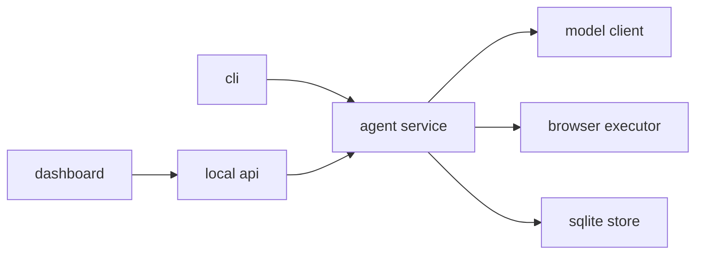

# computer-using-agent

> **Archived.** This is a snapshot of an early computer-use playground. Development has moved elsewhere, so read the code as reference, not as a maintained project.

A local harness for computer-use agents where a person approves the risky steps. It takes a screenshot of a browser, asks an OpenAI [computer-use model](https://developers.openai.com/api/docs/guides/tools-computer-use) what to do next, runs the actions through Playwright, and stops for approval before anything that changes the page.

It is a small base for approval-gated workflows. It is not a hosted product, it is not multi-user, and it is not a security sandbox. Keep real tasks narrow and harmless, and try a fixture before a real website.

## Try it

You need Node.js 22 or newer, because the session store uses `node:sqlite`.

```bash
npm install
npm run cli --workspace @cua/agent -- start "click the mock button"
```

```text
session_98548748-ee8c-4bcc-8147-b0ee7a6fccc6 status=awaiting_approval pending=1
```

```bash
npm run cli --workspace @cua/agent -- approve session_98548748-ee8c-4bcc-8147-b0ee7a6fccc6
```

```text
session_98548748-ee8c-4bcc-8147-b0ee7a6fccc6 status=completed
```

The default mode uses a fake model and a fake browser. It needs no API key and no Chromium, and it still goes through the session store, the approval pause and the export (`export <sessionId>` prints the session as JSON).

## How it works

**The model proposes, the harness decides.** The model returns a batch of actions. The loop pauses on a click, a double click, typing, a keypress or a drag. It pauses on anything the model marks as sensitive, on an action it does not recognize, and on a domain that is denied or outside the allowlist. It also pauses on any safety check OpenAI returns. Scrolling, waiting and mouse moves go through on their own.

Every batch is also scanned, along with the page address, for words like payment, submit, delete, sign in, cart and upload. A match pauses the run, and in a workflow run the checkpoint is recorded on the session. The loop fails a session that takes more than 20 model turns between approvals.

Approving executes exactly the batch that was stored. Rejecting records a reason and runs nothing.

**A session is a list of events.** A screenshot, a model turn, an approval request and an executed batch are each an event, appended to SQLite. One reducer turns the events into the current state of the session and saves that beside them, so a session can be approved, resumed or exported after a restart. Screenshots and the raw model responses are saved as files next to the database.

**The ends are swappable.** The loop talks to a model client, a browser executor and a session store, each a small interface. The defaults are fakes, which is also what the tests use. The suite never calls OpenAI, and it launches a browser only when `CUA_RUN_BROWSER_TESTS=1` is set.

**Real mode** uses the Responses API with the `computer` tool and `gpt-5.4`. The browser is a visible Chromium window at 1024 by 768, with its own profile for each session and extensions off. `CUA_COMPUTER_USE_MODE=preview` switches to the older `computer-use-preview` model.

```bash
npx playwright install chromium
OPENAI_API_KEY=... CUA_ALLOW_DOMAINS=example.com CUA_START_URL=https://example.com \
  npm run cli --workspace @cua/agent -- start "inspect the page title" --real
```

Pass `--real` again (or set `CUA_REAL_MODE=1`) on `resume` and `approve`. Without it those commands use the fake adapters.

## Workflows

A workflow is a task template with typed inputs, a prompt, an optional domain policy and an optional fixture page. There is one, `food-order`. Its fixture is a local food-delivery-style page with fake restaurants, a fake cart and a fake checkout review, so you can watch the agent browse, compare and fill a cart without a real account or payment.

```bash
npm run cli --workspace @cua/agent -- workflow list
npm run cli --workspace @cua/agent -- workflow describe food-order
npm run cli --workspace @cua/agent -- workflow start food-order --mode fixture --input cuisine=thai --input budget=30 --input servings=2
```

`--real` switches to the real model and browser, and `--mode` picks where the workflow starts. The `browse` and `real` modes start from the `startUrl` input and limit the run to that site's domain unless you set an allowlist yourself. They are still approval-gated. Do not point them at a real account or a real purchase.

## Commands

```bash
npm run cli --workspace @cua/agent -- serve [--real]
npm run cli --workspace @cua/agent -- start "task" [--real]
npm run cli --workspace @cua/agent -- resume <sessionId> [--real]
npm run cli --workspace @cua/agent -- list
npm run cli --workspace @cua/agent -- approve <sessionId> [--real]
npm run cli --workspace @cua/agent -- reject <sessionId> [reason]
npm run cli --workspace @cua/agent -- watch <sessionId>
npm run cli --workspace @cua/agent -- export <sessionId>
npm run cli --workspace @cua/agent -- workflow list
npm run cli --workspace @cua/agent -- workflow describe <workflowId>
npm run cli --workspace @cua/agent -- workflow start <workflowId> [--mode fixture|browse|real] [--input key=value] [--real]
npm run cli --workspace @cua/agent -- workflow export <sessionId>
```

`watch` prints new events until the session is `completed`, `failed`, `blocked` or `rejected`. It keeps running while a session waits for approval.

## Configuration

Copy `.env.example` to `.env` if you want a local file.

| Variable | Default | Purpose |
| --- | --- | --- |
| `OPENAI_API_KEY` | empty | Needed only in real mode. |
| `CUA_MODEL` | `gpt-5.4` | Model for the real adapter. In preview mode the default is `computer-use-preview`. |
| `CUA_REASONING_EFFORT` | `xhigh` | Reasoning effort sent with each turn. It is not used in preview mode. |
| `CUA_REAL_MODE` | `0` | `1` turns on real mode, like `--real`. |
| `CUA_COMPUTER_USE_MODE` | `ga` | `ga` for the `computer` tool, `preview` for the older one. |
| `CUA_DATA_DIR` | `.cua-data` | The database, screenshots, raw responses and browser profiles. |
| `CUA_PORT` | `4317` | Port for the local API. |
| `CUA_START_URL` | `about:blank` | First page for a new session. |
| `CUA_ALLOW_DOMAINS` | empty | Comma-separated allowlist. |
| `CUA_DENY_DOMAINS` | empty | Comma-separated denylist. |

The data directory is relative to where the command runs. Through `npm run --workspace` that is `packages/agent`. It holds `sessions.sqlite`, then `artifacts/<sessionId>/screenshots` and `model`, and `browser/<sessionId>` for each session's profile. Treat it and any exports as private if a task touched a real site.

## API and dashboard

`npm run dev` starts the API and the dashboard together. It runs the API in fake mode unless `CUA_REAL_MODE=1` is set. The API listens on `127.0.0.1:4317` and has no authentication. The dashboard is on `127.0.0.1:5173`.

The routes mirror the CLI: tasks, sessions with approve, resume, reject and export, workflows, fixtures, and the saved artifacts, all under `/api` ([`packages/agent/src/server/app.ts`](packages/agent/src/server/app.ts)).

The dashboard is thin. It starts tasks and workflows, lists sessions, shows the latest screenshot and the event trace, and approves or rejects a pending batch. It refreshes after your actions, not live.

## Layout



`packages/core` holds the shared types, the event reducer and the approval policy. `packages/agent` holds the loop, the CLI, the API and the adapters. `apps/dashboard` is the React page.

Run the checks with `npm run check`, `npm test` and `npm run build`.

## License

MIT. See [LICENSE](./LICENSE).
